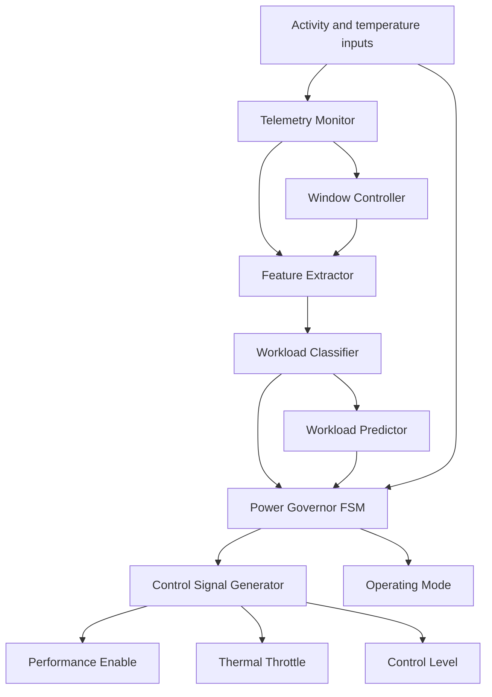

# PwrGov-X: Telemetry-Driven Power Governor IP

A parameter-conscious digital power-governor IP implemented in Verilog-2001 for Tiny Tapeout using the SkyWater SKY130 ASIC design flow. PwrGov-X monitors activity and temperature inputs, classifies workload, tracks workload trends, and generates power-management control signals with thermal throttling and hysteresis.

## Highlights

- Verilog-2001 RTL design using eight modules
- Tiny Tapeout standard interface with `clk`, `rst_n`, `ena`, `ui_in`, `uo_out`, `uio_in`, `uio_out`, and `uio_oe`
- Activity monitoring over a fixed 16-cycle window
- Workload classification into low, medium, and high categories
- Workload-trend prediction
- Finite-state-machine-based power-mode selection
- Thermal throttling with hysteresis
- Cocotb integration test and gate-level verification
- Automated SKY130 physical-design flow using the Tiny Tapeout GitHub Actions workflow

## Motivation

Digital systems such as CPUs, system-on-chips, embedded processors, and AI accelerators must balance performance and power consumption. Continuously operating at maximum performance can waste energy when the workload is light, while elevated temperature may require performance throttling.

PwrGov-X explores a lightweight hardware approach to this problem by using activity and temperature telemetry to select a suitable operating mode.

This project is an educational RTL and ASIC implementation exercise. It is not a replacement for a production power-management unit or a complete commercial dynamic-voltage-and-frequency-scaling controller.

## Architecture

The design is divided into eight RTL modules:

| Module | Responsibility |
|---|---|
| `tt_um_pwrgovx` | Top-level Tiny Tapeout wrapper and signal mapping |
| `telemetry_monitor` | Tracks active, idle, and total cycle counts |
| `window_controller` | Controls the telemetry measurement window |
| `feature_extractor` | Produces an activity metric from telemetry counters |
| `workload_classifier` | Classifies workload using the extracted activity metric |
| `workload_predictor` | Tracks workload trends |
| `pwrgov_fsm` | Selects the operating mode and manages thermal hysteresis |
| `control_signal_generator` | Generates performance, throttle, and control-level outputs |

### Functional flow



### Operating modes

| Mode | Encoding | Description |
|---|---|---|
| Low power | `2'b00` | Reduced-activity operating mode |
| Normal | `2'b01` | Normal operating mode |
| Throttled | `2'b10` | Thermal-protection mode |

The FSM requests thermal throttling when the temperature code reaches 6 or higher. Once throttling is active, it remains active at temperature code 5 and releases at code 4 or lower. This hysteresis helps prevent rapid switching around the threshold.

When the enable request is inactive, the design returns to its low-power mode.

## Tiny Tapeout Interface

The top-level module is `tt_um_pwrgovx`.

### Inputs

| Signal | Description |
|---|---|
| `clk` | Clock input |
| `rst_n` | Active-low reset |
| `ena` | Tiny Tapeout design enable |
| `ui_in[0]` | Enable request |
| `ui_in[1]` | Activity input |
| `ui_in[4:2]` | Three-bit temperature code |
| `ui_in[7:5]` | Reserved inputs |
| `uio_in[7:0]` | Unused bidirectional input bus |

The internal enable request is formed from `ena` and `ui_in[0]`.

### Outputs

| Signal | Description |
|---|---|
| `uo_out[0]` | Performance enable |
| `uo_out[1]` | Throttle active |
| `uo_out[3:2]` | Control level |
| `uo_out[5:4]` | Workload class |
| `uo_out[7:6]` | Operating mode |
| `uio_out[7:0]` | Held at zero |
| `uio_oe[7:0]` | Held at zero; bidirectional pins disabled |

### Workload classification

The implementation uses the active-cycle count within its measurement window to distinguish workload levels:

| Active samples | Class encoding | Classification |
|---|---|---|
| 0–3 | `2'b00` | Low |
| 4–9 | `2'b01` | Medium |
| 10–16 | `2'b10` | High |

The workload trend is represented internally as stable (`00`), rising (`01`), or falling (`10`).

## Verification

The project includes a Cocotb integration test in `test/test.py` and the Tiny Tapeout test harness in `test/tb.v`.

The integration test checks:

- Reset behavior and low-power mode
- Thermal throttle entry at temperature code 6
- Thermal hysteresis at temperature code 5
- Throttle release at temperature code 4
- Safe outputs when the enable request is disabled
- Unused bidirectional outputs and output enables remaining low

The successful GitHub Actions GDS workflow reports the following job results:

| Check | Result |
|---|---|
| GDS generation | Passed |
| Tiny Tapeout precheck | Passed |
| Gate-level test (`gl_test`) | Passed |
| Viewer deployment | Passed |

These results demonstrate that the design completed the configured automated flow and passed the reported checks. They do not, by themselves, establish that the design has been accepted for a shuttle or fabricated.

## Physical Design

The successful GDS workflow reported these routing statistics:

| Metric | Recorded result |
|---|---:|
| Routing utilization | 8.374% |
| Reported wire length | 2,569 µm |
| GDS generation | Successful |

The workflow also reported 449 linter warnings. These warnings should be inspected and understood before a fabrication submission; a successful workflow does not mean that every warning is irrelevant.

The reported values are EDA flow results, not measurements from fabricated silicon. For reproducibility, retain the successful workflow URL, commit identifier, GDS artifacts, and accompanying reports.

## Repository Structure

```text
power_governer_tiny_tapeout/
├── .github/workflows/   # Automated test and GDS workflows
├── docs/
│   └── info.md          # Tiny Tapeout project documentation
├── src/
│   └── project.v        # Top wrapper and PwrGov-X RTL modules
├── test/
│   ├── Makefile         # Cocotb simulation configuration
│   ├── tb.v             # Tiny Tapeout test harness
│   └── test.py          # Cocotb integration test
├── info.yaml            # Project metadata and pin descriptions
└── README.md            # Project overview and technical documentation
```

## Limitations and Future Work

- The current activity and temperature signals are simplified telemetry inputs for demonstrating power-governor behavior.
- Workload classification and trend prediction use lightweight digital logic rather than a complex workload prediction algorithm.
- The current design does not implement actual voltage scaling, clock-frequency scaling, or a physical power-delivery controller.
- The reported physical-design warnings should be reviewed before any fabrication submission.
- Future work could include more extensive workload verification, additional temperature and activity scenarios, power estimation, and hardware-level validation.

## Team Members

- **Shreyas C N** — [GitHub](https://github.com/ShreyasCN-19)
- **Thejas Gowda KR** — [GitHub](https://github.com/thejasgowda-05)
- **Varun K B** — [GitHub](https://github.com/VarunKB06)
- **Rahul A R** — [GitHub](https://github.com/rahular2005)

## Authors
- **Shreyas C N** — [GitHub](https://github.com/ShreyasCN-19)
- **Thejas Gowda K R** — [GitHub](https://github.com/thejasgowda-05)

## Guide
- Dr.Rakhi S

## Institution 
- **Atria Institute of Technology**
  
## Acknowledgements

Built using the Tiny Tapeout Verilog project template, the SKY130 process design kit, Cocotb, and the automated Tiny Tapeout physical-design workflow.

- Tiny Tapeout: https://tinytapeout.com/
- Repository: https://github.com/ShreyasCN-19/power_governer_tiny_tapeout
